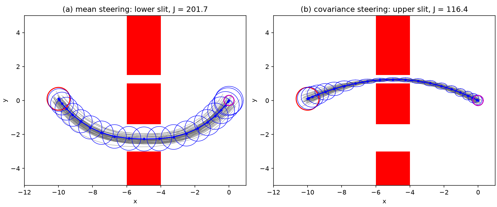

# Covariance Steering for Stochastic Vehicle Path Planning: A Reproduction

A Python reproduction of

> K. Okamoto and P. Tsiotras, "Optimal Stochastic Vehicle Path Planning Using Covariance Steering," *IEEE Robotics and Automation Letters*, 4(3):2276–2281, 2019. [doi:10.1109/LRA.2019.2901546](https://doi.org/10.1109/LRA.2019.2901546)

The method plans a vehicle's **mean path and its uncertainty** together. A feedback policy shrinks the state covariance where it matters, and chance constraints keep each obstacle face violated with probability at most ε. Obstacles are handled with mixed-integer region selection. The result: a planner that can take narrow passages a mean-only planner must avoid.



## Results

| Experiment | Planner | Route | Cost J |
|---|---|---|---|
| Upper slit 0.5 wide (paper Fig. 2) | mean steering (K = 0) | lower slit (detour) | 201.7 |
| | covariance steering | **upper slit** | **116.4** |
| Upper slit 0.2 wide (paper Fig. 4) | covariance steering | lower slit | 139.1 |

- Both qualitative results of the paper are reproduced. The covariance-steering solutions are certified optimal (relative gap ≤ 1e-5).
- A slit-width sweep (extra analysis) shows that the route switches between widths 0.25 and 0.225. The switch is driven by the *mean* cost of crossing the wall in fewer time steps.
- 200,000-run Monte Carlo checks:
  - per-face violation rates are about ε = 0.001;
  - terminal covariance targets are met exactly;
  - covariance steering has zero collisions at the sampled time steps.

  Full table: [`results/verification.md`](results/verification.md).

## Repository layout

| Path | Contents |
|---|---|
| [`covsteer_repro.py`](covsteer_repro.py) | The whole method as steps 0–8, commented with the paper's equation numbers |
| [`notebooks/covsteer_walkthrough.ipynb`](notebooks/covsteer_walkthrough.ipynb) | Teaching notebook: every equation derived, implemented, and checked |
| [`slides/optimal_covariance_control.qmd`](slides/optimal_covariance_control.qmd) | Presentation source (Quarto → PowerPoint); rendered `.pptx` alongside |
| `figs/` | Figures produced by the script, named after the slide they appear on |
| `results/` | Verification table, width-sweep data |

## Setup

```bash
conda env create -f environment.yml
conda activate covsteer
python -m ipykernel install --user --name covsteer --display-name "Python (covsteer)"
```

The mixed-integer steps (5–8) need [MOSEK](https://www.mosek.com/products/academic-licenses/), which offers free academic licenses. Put the license at `~/mosek/mosek.lic`. Steps 0–4 fall back to the open-source Clarabel solver.

## Usage

```bash
python covsteer_repro.py --step N
```

| Step | What it does | Paper | Time |
|---|---|---|---|
| 0 | solver check | — | s |
| 1 | double integrator, lifted dynamics (checked against step-by-step simulation) | Eq. 1, 7 | s |
| 2 | open loop: the covariance only grows | Sec. I | s |
| 3 | Theorem 1 covariance steering, no obstacles | Eq. 12–19 | s |
| 4 | chance constraints through a narrow gate | Eq. 20 | s |
| 5 | Algorithm 1 on the double slit | Eq. 22–25, Fig. 2–3 | ~1 min |
| 6 | narrower upper slit | Fig. 4 | ~1 min |
| 7 | slit-width sweep | — | ~12 min |
| 8 | Monte Carlo verification (needs steps 5–6 first) | — | s |

Notebook: open `notebooks/covsteer_walkthrough.ipynb` with the **Python (covsteer)** kernel. It runs top to bottom in about 90 s.

Slides: `quarto render slides/optimal_covariance_control.qmd`.

## Implementation notes

- **Mixed-integer SDP workaround.** MOSEK cannot solve mixed-integer semidefinite programs, and the terminal covariance constraint (Eq. 19) is semidefinite. We enforce it with second-order-cone cutting planes. A lower/upper-bound certificate proves optimality:
  - the relaxed problem gives a lower bound;
  - fixing the chosen route and solving the exact convex SDP gives an upper bound.

  The paper used YALMIP, which runs its own branch and bound for this case.
- **Assumed** (the paper does not report them): initial and target distributions μ₀, Σ₀, Σ_N, and cost weights Q = 0, R = I.
- **Reconstructed**: the obstacle and sub-region geometry was read off the paper's Figs. 2, 3, 4 and 6 by eye.

Every assumed or reconstructed value is tagged `# ASSUMED` / `# RECONSTRUCTED` in the code.

The paper PDF is not included in this repository.
