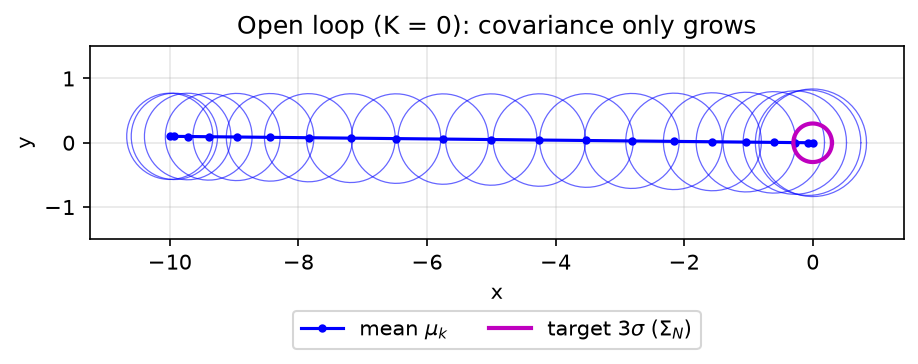
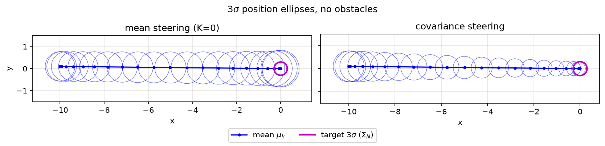
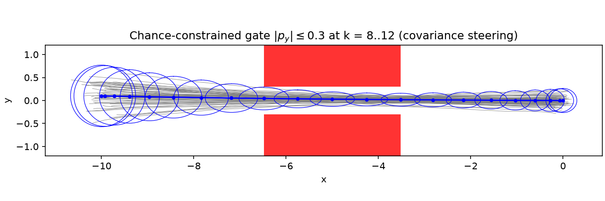
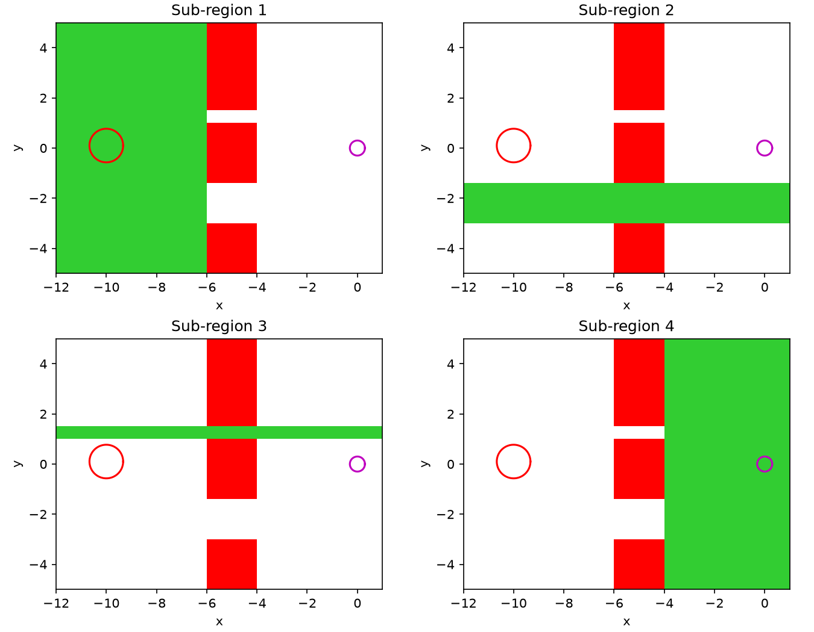
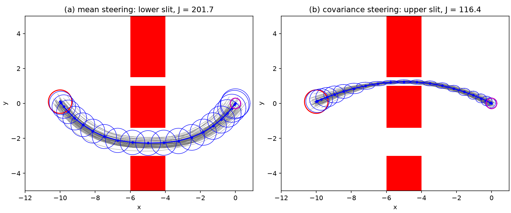
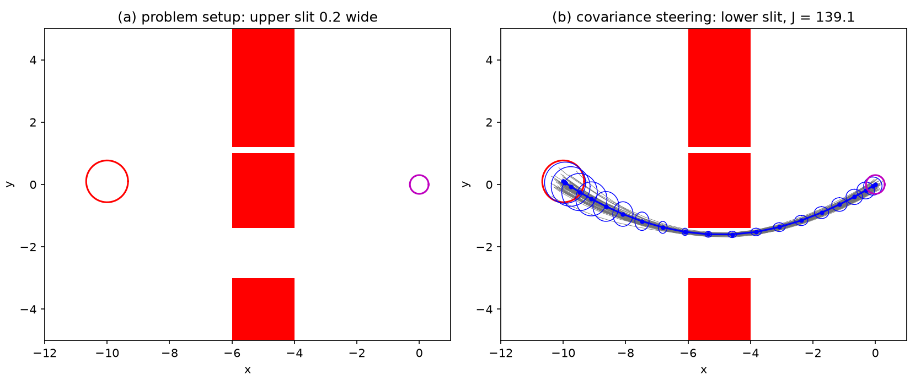
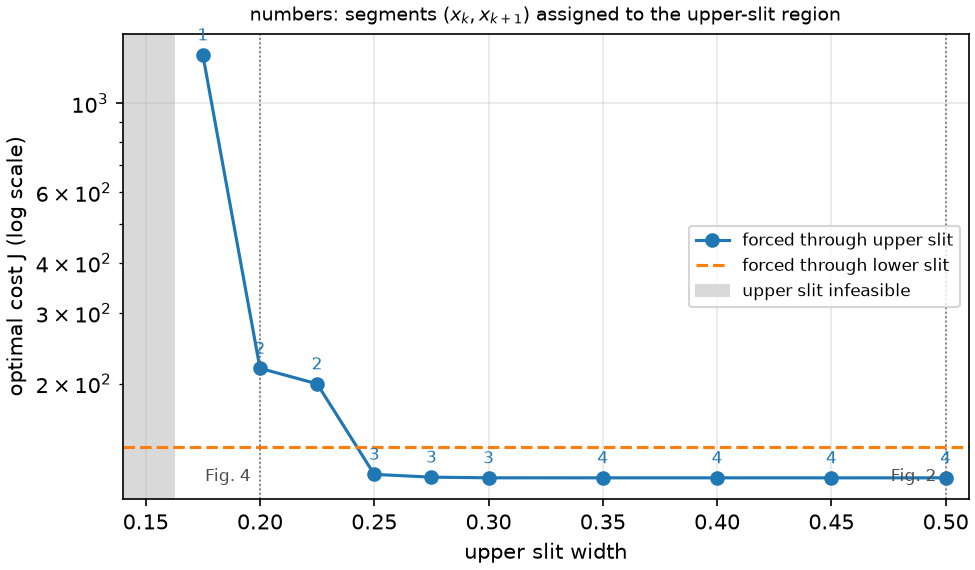

## 1. Source Paper

K. Okamoto and P. Tsiotras, *Optimal Stochastic Vehicle Path Planning Using Covariance Steering*, IEEE Robotics and Automation Letters, 4(3):2276–2281, 2019.

- Builds on their convex covariance-steering method (Okamoto, Goldshtein & Tsiotras, IEEE Control Systems Letters, 2018).
- This project re-implements the method in Python (cvxpy + MOSEK) and reproduces the double-slit experiments.

::: {.notes}
Add course, instructor and date before presenting.
:::

## 2. Motivation: Why Control Uncertainty?

- Stochastic disturbances cause realized trajectories to deviate from the nominal path.
- Planning only the expected trajectory may be inadequate near obstacles or in narrow corridors.
- Feedback can shape the covariance, but uncertainty reduction incurs control cost.

**Central idea:** plan the mean trajectory **and** its uncertainty.

::: {.notes}
The double-slit figure (slide 16) can be previewed here as the motivating picture.
:::

## 3. Problem Statement and Objectives

**Research question:** How can optimal covariance control improve stochastic path planning subject to probabilistic safety and terminal-state constraints?

- Implement the mean-only baseline and feedback covariance steering.
- Reproduce the original and narrower double-slit experiments.
- Validate terminal conditions, chance constraints, and empirical safety.

::: {.notes}
Scope: Sec. II-IV-B of the paper. Not reproduced: the runtime comparison with [20] (Sec. IV-A, Fig. 1) and the random-obstacle example (Fig. 5).
:::

## 4. General Stochastic Optimal Control Problem

Consider a finite-horizon linear Gaussian system:

$$
x_{k+1}=Ax_k+Bu_k+Dw_k,\qquad k=0,\ldots,N-1,
$$

$$
x_0\sim\mathcal N(\mu_0,\Sigma_0),\qquad w_k\sim\mathcal N(0,I).
$$

**Goal:** steer $x_N$ to $\mathcal N(\mu_N,\Sigma_N)$ at minimum expected cost, while every $x_k$ stays in free space with probability $\ge 1-\epsilon$.

::: {.notes}
Explain x, u, w, A, B, D, horizon N. Do not specialize the matrices to a vehicle here.
:::

## 5. Propagating Mean and Covariance

:::: {.columns}
::: {.column width="45%"}
Open loop, $u_k=v_k$:

$$
\mu_{k+1}=A\mu_k+Bv_k
$$

$$
\Sigma_{k+1}=A\Sigma_kA^\top+DD^\top
$$

$v_k$ never enters the covariance recursion. The spread only grows.
:::
::: {.column width="55%"}

Terminal position variance: 0.078 (target 0.01).
:::
::::

::: {.notes}
Derive the covariance recursion using independence and zero mean of w. Verified in code (step 2): recursion and lifted form agree to 1e-15; 5,000 Monte Carlo runs match.
:::

## 6. The Auxiliary-State Feedback Policy

The paper's policy (Theorem 1):

$$
u_k=v_k+K_ky_k,
\qquad
y_{k+1}=Ay_k+Dw_k,\quad y_0=x_0-\mu_0.
$$

- $v_k$: planned (feed-forward) control, which moves the mean.
- $K_ky_k$: feedback correction, which shapes the spread.
- $y_k$ is driven by noise only. It does **not** depend on $K$, which keeps the problem convex.

::: {.notes}
y_k is NOT x_k - mu_k once feedback is on: in simulation the difference reaches 0.32 at k = 10. y is implementable because D is invertible: D w_k = x_{k+1} - A x_k - B u_k. Feeding back x - mu instead would make the covariance a product of gains, which is non-convex.
:::

## 7. Lifted Finite-Horizon Dynamics

Stack the state and input trajectories:

$$
X=\begin{bmatrix}x_0\\x_1\\\vdots\\x_N\end{bmatrix},
\qquad
U=\begin{bmatrix}u_0\\u_1\\\vdots\\u_{N-1}\end{bmatrix}.
$$

The dynamics become

$$
X=\mathcal A x_0+\mathcal B U+\mathcal D W,
$$

with the feedback policy $U=V+KY$ and block-diagonal $K$ (blocks $K_0,\ldots,K_{N-1}$).

::: {.notes}
Block row k: A_cal = A^k, B_cal[k,j] = A^(k-1-j) B for j < k. Block-diagonal K has O(N nx nu) entries versus O(N^2 nx nu) in [20] (Remark 2). Verified: the step-by-step and stacked trajectories agree to 9e-16.
:::

## 8. Mean and Covariance Under Feedback

With $Y=\mathcal A y_0+\mathcal D W$ and $S=\Sigma_Y=\mathcal A\Sigma_0\mathcal A^\top+\mathcal D\mathcal D^\top$:

$$
\boxed{\bar X=\mathcal A\mu_0+\mathcal B V}
$$

$$
\boxed{\Sigma_X=(I+\mathcal B K)S(I+\mathcal B K)^\top}
$$

**Takeaway:** $V$ shapes the mean only; $K$ shapes the covariance only.

::: {.notes}
Derived from X = A mu0 + B V + (I + B K) Y with E[Y] = 0 and Cov(Y) = S. In code we use the exact factor L = [A_cal Sigma_0^(1/2), D_cal], so that L L^T = S.
:::

## 8b. Feedback Reaches the Target Covariance

::: {.notes}
20,000 Monte Carlo runs of the actual policy. The cost rises only from 93.99 to 94.03.
:::

## 9. Expected Optimal Control Cost

Paper Eq. (17), split into mean and covariance parts:

$$
J=\underbrace{\bar X^\top\bar Q\bar X+V^\top\bar RV}_{J_{\mathrm{mean}}(V)}
+\underbrace{\operatorname{tr}\!\big[\big((I+\mathcal BK)^\top\bar Q(I+\mathcal BK)+K^\top\bar RK\big)S\big]}_{J_{\mathrm{cov}}(K)}
$$

- $Q_k,R_k$ are not reported in the paper. **We use $Q_k=0$, $R_k=I$.**
- Free space: $J=93.99\ (\text{mean})+0.04\ (\text{cov})$. Shrinking uncertainty is cheap until obstacles demand it mid-path.

::: {.notes}
The separated design of Eq. (21) uses different weights for the two parts. Monte Carlo average cost 94.05 vs predicted 94.03.
:::

## 10. Terminal Distribution Constraints

The target mean is imposed exactly:

$$
E_N\bar X=\mu_N.
$$

The target covariance is relaxed to an upper bound (Eq. 19):

$$
E_N\Sigma_X E_N^\top\preceq\Sigma_N
\iff
\big\|\Sigma_N^{-1/2}E_N(I+\mathcal BK)S^{1/2}\big\|_2\le 1.
$$

**Interpretation:** the final uncertainty must not exceed the target in any direction.

::: {.notes}
Equality is not convex. The PSD inequality is convex (a spectral-norm constraint, i.e. an SDP). In every covariance-steering solution the constraint is active: lambda_max(Sigma_xN - Sigma_N) is about 1e-12.
:::

## 11. Chance Constraints and Gaussian Safety Margins

For a half-space $a^\top x_k\le b$, require $\Pr(a^\top x_k>b)\le\epsilon$. Since $a^\top x_k$ is Gaussian (Eq. 20):

$$
\boxed{a^\top\mu_k+\Phi^{-1}(1-\epsilon)\,\big\|S^{1/2}(I+\mathcal BK)^\top E_k^\top a\big\|\le b}
$$

- The safety margin grows with the uncertainty in direction $a$.
- The norm is a second-order cone in $(V,K)$, so the problem stays convex.
- $\epsilon=10^{-3}$ gives $\Phi^{-1}(1-\epsilon)=3.09$.

::: {.notes}
Derived by standardizing the scalar Gaussian a^T x_k.
:::

## 11b. Checking the Chance Constraint

::: {.notes}
The gate is a test we added (step 4); it is not in the paper. 400,000 Monte Carlo runs, standard error about 5e-5. Only the k = 8 constraint is active; later steps have slack.
:::

## 12. Obstacle Avoidance as Convex-Region Selection

:::: {.columns}
::: {.column width="50%"}
Free space = union of overlapping boxes $\mathcal R_r$ (Eq. 22).

Binary $M_{r,k}=1$: $x_k$ **and** $x_{k+1}$ lie in $\mathcal R_r$.

$$
\textstyle\sum_r M_{r,k}=1
$$

$$
M_{r,k}=1\Rightarrow\text{(25) at }x_k,x_{k+1}
$$
:::
::: {.column width="50%"}

:::
::::

::: {.notes}
Both segment endpoints lie in the same convex box, so the straight segment between them does too (Deits and Tedrake). The implication is enforced with big-M = 30. This value is valid because workspace-wall chance constraints are always imposed, which bounds every left-hand side by 28. All faces are axis-aligned, so only two SOCs per step are needed (sigma_x, sigma_y). Sub-regions reconstructed from paper Fig. 3.
:::

## 13. Putting the Optimization Together

$$
\min_{V,K,M}\ J_{\mathrm{mean}}(V)+J_{\mathrm{cov}}(K)
$$

subject to:

- terminal mean (18a) and terminal covariance (19)
- region selection (24) and chance constraints (25)
- bounds $|V|\le100$, $|K|\le10$

**Result:** a mixed-integer conic program. The paper used YALMIP + MOSEK.

::: {.notes}
Our solver approach is on the backup slide "Solving the Mixed-Integer Problem".
:::

## 14. Numerical Example: Planar Vehicle Model

Now specialize the general theory to a planar double integrator:

$$
x_k=\begin{bmatrix}p_x&p_y&v_x&v_y\end{bmatrix}^\top,
\qquad
u_k=\begin{bmatrix}a_x&a_y\end{bmatrix}^\top.
$$

$$
A=\begin{bmatrix}
1&0&\Delta t&0\\
0&1&0&\Delta t\\
0&0&1&0\\
0&0&0&1
\end{bmatrix},\qquad
B=\begin{bmatrix}
\Delta t^2/2&0\\
0&\Delta t^2/2\\
\Delta t&0\\
0&\Delta t
\end{bmatrix}.
$$

::: {.notes}
First introduction of the concrete double-integrator model, after the complete theoretical development.
:::

## 15. Simulation Parameters and Boundary Conditions

| Parameter | Value | Source |
|---|---|---|
| Δt, N | 0.2, 20 | paper |
| D, ε | 0.01·I, 0.001 per face | paper |
| bounds | abs(V) ≤ 100, abs(K) ≤ 10 | paper |
| μ0, μN | (−10, 0.1, 0, 0), 0 | assumed |
| Σ0 | diag(0.05, 0.05, 0.001, 0.001) | assumed |
| ΣN | diag(0.01, 0.01, 0.001, 0.001) | assumed |
| Q, R | 0, I | assumed |
| wall, slits | x ∈ [−6, −4]; y ∈ [1, 1.5] and [−3, −1.4] | reconstructed |

::: {.notes}
Assumed μ0, Σ0, ΣN were chosen so that the 3-sigma start and target circles match the sizes drawn in paper Fig. 2. Geometry read off Figs. 2, 3 and 6; Fig. 6 gives the corner (-6, -1.4). Solver: cvxpy 1.9.3 + MOSEK 11.2.8.
:::

## 16. Experiment 1: Covariance Steering Takes the Narrow Slit

::: {.notes}
Matches paper Fig. 2. Gray: 60 Monte Carlo runs of the actual policy. Blue: 3-sigma ellipses. Red: initial 3-sigma. Magenta: target. Covariance steering: J = 115.99 (mean) + 0.43 (covariance), certified optimal (gap 5e-10), 48 s. Region sequence: R1 x8, R3 x4, R4 x8.
:::

## 17. Experiment 2: Narrower Slit, the Planner Detours

::: {.notes}
Matches paper Fig. 4. Width 0.2 read off Fig. 4(a). This lower path is much cheaper than mean steering's (139.1 vs 201.7): the tight covariance lets the mean hug the obstacle corner, as in the paper's Fig. 4(b). The upper slit is still feasible at width 0.2 (J = 218.4), so the switch is a cost decision.
:::

## 17b. Why the Route Switches: Slit-Width Sweep

:::: {.columns}
::: {.column width="55%"}

:::
::: {.column width="45%"}
- Width ≥ 0.25: upper route cheaper (J ≈ 116–119 vs 139).
- Width ≤ 0.225: lower route cheaper. Upper is infeasible at 0.15.
- The jump is in the **mean** cost: the vehicle must dash through the wall in fewer time steps (2 segments instead of 3).
:::
::::

::: {.notes}
Extra analysis, not in the paper. Each point: covariance steering with the route forced. Numbers on points: segments (x_k, x_{k+1}) assigned to the upper-slit region. At width 0.25 the crossing takes 3 steps (peak speed 3.8); at 0.225 it takes 2 steps (peak 5.7), because it is cheaper to dash than to hold 3.09 sigma_y inside the slit at a further sample. This is partly a discrete-time effect: constraints are imposed at sample times only. The gain bound is not active (max |K| = 4.4). The lower-route cost does not depend on the upper-slit width.
:::

## 18. Verification and Performance Comparison

| Metric | 0.5 mean | 0.5 cov | 0.2 mean | 0.2 cov |
|---|---|---|---|---|
| route | lower | **upper** | lower | lower |
| optimal J / MC avg. | 201.7 / 201.7 | 116.4 / 116.4 | 201.7 / 201.7 | 139.1 / 139.1 |
| terminal cov. ≤ ΣN | no (+0.069) | yes | no (+0.069) | yes |
| worst per-face violation | 0.00111 | 0.00109 | 0.00111 | 0.00114 |
| collision, sampled steps | 0.00125 | 0 | 0.00125 | 0 |
| collision, continuous path | 0.00136 | 0.00001 | 0.00136 | 0.00011 |
| solve time [s] | 0.7 | 48 | 0.6 | 40 |

::: {.notes}
200,000 Monte Carlo runs per case; epsilon = 0.001 per face.
Mean steering does not impose (19), so its terminal covariance misses the target, as the paper notes. Per-face violation is the maximum over many active faces of a noisy estimate (standard error 7e-5), so values slightly above 1e-3 are expected. Most violated faces of the covariance-steering solutions are band edges far from the wall, which are not real obstacles: the conservatism of the decomposition that the paper discusses with Fig. 6. Continuous check: the exact zero-order-hold path p(t) = p_k + v_k t + u_k t^2/2 at 10 points per interval. Terminal mean error is at most 2e-9 in all cases.
:::

## 19. Conclusions and Limitations

- **Reproduced:** covariance steering uses the narrow slit (Fig. 2) and detours once it narrows (Fig. 4).
- Feedback is cheap in itself (covariance cost < 1). Its value is in **enabling** cheaper mean paths.
- Chance constraints hold at the ε level in Monte Carlo; terminal covariance is met exactly.
- **Limitations:** assumed parameters, reconstructed geometry, per-sample safety only, hand-made regions.

::: {.notes}
Continuous-time collision rate is slightly above the sampled-step rate (up to 0.00011 for covariance steering). Future work (paper): automatic, less conservative convex decomposition (e.g. IRIS, ref. [35]).
:::

## Backup: Solving the Mixed-Integer Problem

MOSEK cannot solve mixed-integer SDPs, and (19) is an SDP. Exact cutting planes:

- (19) holds when $\|M_{\mathrm{term}}^\top z\|\le 1$ for all unit $z$; start with 16 directions.
- **Lower bound:** relaxed mixed-integer SOCP.
- **Upper bound:** fix the route, solve the exact convex SDP.
- Stop at gap < $10^{-4}$, else add the most violated $z$.

::: {.notes}
All runs certified on the first iteration. YALMIP (used by the paper) runs its own branch and bound for MI-SDP. Without the bound certificate, plain cutting planes needed 14 iterations and 465 s for Experiment 1; with it, 48 s.
:::

## Backup: Reproduction Code Map

| Step | Content | Paper |
|---|---|---|
| 0–1 | solver check, lifted dynamics | Eq. 1, 7 |
| 2 | open loop, covariance growth | Sec. I |
| 3 | Theorem 1 covariance steering | Eq. 12–19 |
| 4 | chance-constrained gate | Eq. 20 |
| 5 | Algorithm 1, double slit | Eq. 22–25, Figs. 2–3 |
| 6–7 | narrow slit, width sweep | Fig. 4 |
| 8 | Monte Carlo verification | — |

::: {.notes}
Run: ~/.conda/envs/covsteer/bin/python covsteer_repro.py --step N
:::
